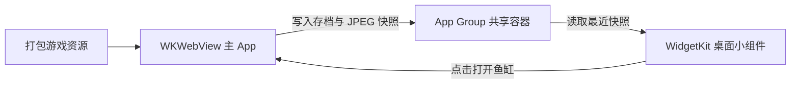

# 一缸微光 iOS 真机部署复盘与后续迭代计划

2026-10-21，一缸微光完成从 Mac 环境准备、模拟器构建测试，到个人 iPhone 安装和桌面小组件使用的流程。开发者已确认整体业务流程跑通。后续工作的重点是保留这份可复现基线，持续改善游戏体验，再建立适合更多玩家的安装与更新渠道。

当前交付方式是 Personal Team 开发签名。面向其他玩家的 TestFlight 或 App Store 分发仍是下一阶段工作。

## 本次成功基线

| 项目 | 本次结果 |
| --- | --- |
| Mac | Apple Silicon，macOS 26.6 |
| 开发工具 | Xcode 27.1，已完成首次启动和协议确认 |
| 模拟器 | iOS 27.1，App 与 Widget 构建成功 |
| 自动测试 | 3 项 XCTest 全部通过，0 失败 |
| 真机 | iPhone 16，iOS 26.6.1，已安装并启动游戏 |
| 签名 | Personal Team 自动签名，App 与 Widget 的描述文件包含同一 App Group 和目标手机 |
| 业务验收 | 开发者在本次会话中确认手机游戏与小组件整体流程已跑通 |
| 首批描述文件 | 2026-10-28 到期，续签后以新描述文件的到期时间为准 |

自动测试覆盖存档重开、无效写入保护、损坏旧档保留、成对快照发布及无效图片保护。小组件的桌面显示与使用属于真机人工验收，不能由这 3 项存储测试替代。

## 实际跑通的部署顺序

1. **先识别项目依赖。** 这份交付包已包含网页游戏资源，运行原生工程需要完整 Xcode 和 iOS 支持组件。本次没有安装 Node.js、CocoaPods 或额外 Python 包，也没有修改 conda 环境；脚本只用系统 Python 解析 JSON。
2. **完成 Xcode 首次启动。** 安装应用后，还要打开 Xcode、确认协议并安装必要组件。只有 Command Line Tools 时，无法使用完整的 iOS 构建和模拟器工具。
3. **建立模拟器验证基线。** 安装可用的 iOS 运行环境，执行 App、Widget 构建及 XCTest。构建通过后，再确认实际鱼缸页面能打开。
4. **登录账号并连接真实手机。** 在 Xcode 登录 Apple 账号，手机通过数据线连接、解锁并信任 Mac。设备列表中的 `physical` 用于确认目标是真机。
5. **完成手机开发准备。** 开启开发者模式，按提示重启、解锁并再次确认开启，等待 Xcode 完成设备支持准备。
6. **统一签名配置。** 本次最初在 [Configuration.xcconfig](../Configuration.xcconfig) 设置唯一 Bundle ID 前缀和 Team。归档 GitHub 基线时，个人值已迁入被 Git 忽略的 `Configuration.local.xcconfig`，共享配置通过可选 include 读取，保持原来的 App 身份。其他开发者从[本地配置模板](../Configuration.local.xcconfig.example)复制并填写自己的设置。App 与 Widget 使用同一 Team、同一 App Group，开启自动签名。
7. **以真实手机为目标构建。** 允许 Xcode 更新描述文件和登记设备。检查两个 Target 的签名、App Group 授权及描述文件中的目标手机，再安装 App。
8. **完成首次开发者信任。** 本次安装成功后，首次启动仍被 iOS 拦截；在手机“设置 → 通用 → VPN 与设备管理”中信任自己的开发者，才成功启动。
9. **初始化鱼缸并添加组件。** 保持 App 前台至少 10 秒，再回桌面添加“一缸微光”。中号组件显示鱼数和保存时间，便于判断读取的是实际快照还是默认占位画面。

“手机信任 Mac”“开启开发者模式”“信任 App 开发者”是三个不同步骤。完成其中一个，不代表其他步骤已完成。

## 遇到的问题与有效处理方式

| 现象 | 本次判断与处理 | 后续排查原则 |
| --- | --- | --- |
| `xcodebuild` 提示只有 Command Line Tools，找不到 `simctl` | 安装完整 Xcode，确认实际开发工具目录 | 先检查工具链，再排查工程 |
| Xcode 已安装，但命令行提示未同意协议 | 打开 Xcode 完成首次启动 | 安装完成与工具可用要分别确认 |
| 模拟器运行环境下载慢或超时 | 先走 Xcode 官方下载；本次另用 Apple 官方资源分段续传，核对官方 SHA-256 后导入，系统签名验证为 Verified | 运行环境较大，失败时保留可续传进度；资源地址与版本需要重新确认，不能长期硬编码本次下载地址 |
| 模拟器可运行，真机仍无法安装 | 补齐账号、真实设备、签名与描述文件 | 模拟器成功不能代替真机签名验证 |
| 手机显示 `connected (no DDI)`，目标等待超时 | 手机开启开发者模式并重启后，等待 Xcode 准备完成再重试 | 先让设备进入可开发状态，不要反复改游戏代码 |
| 提示团队没有设备，无法生成描述文件 | 本次仅以通用 iOS 目标构建时未登记手机；设备就绪后，改用真实手机 UDID，并允许自动登记设备 | 核对构建目标和描述文件内的设备列表 |
| App 已安装，启动仍提示安全检查失败 | 本次签名与授权验证有效，最终通过手机端开发者信任解决 | 安装与启动是两个验收点；按错误检查签名、授权或信任状态 |
| App 内显示 App Groups 回退提示 | 统一两个 Target 的 Team、签名授权和 Info.plist 中的 Group | 本地回退存档不能作为小组件同步成功的依据 |
| 命令行读不到共享目录下的 `Aquarium` | 设备工具明确限制只允许部分容器子目录访问 | 工具访问受限不等于存档不存在；通过实际组件的画面、鱼数和时间验证，不为调试改动存储结构 |
| 对普通 Apple 账号能否使用 App Groups 存在疑问 | 本次 Personal Team 实际成功生成授权、安装并启动 | 以当前官方能力说明和实际签名结果判断，不直接套用旧经验，也不把单次成功推广到所有团队 |

## 保留下来的日常命令

以下命令均在当前 iOS 项目目录执行。

| 场景 | 命令 | 作用 |
| --- | --- | --- |
| 新 Mac 或补齐模拟器环境 | `bash setup-on-mac.sh` | 检查 Xcode，必要时下载运行环境，选择或创建设备，执行验证 |
| 日常模拟器验证 | `bash validate-on-mac.sh` | 构建 App、Widget，并运行 XCTest |
| 真机更新或到期续签 | `bash install-on-iphone.sh` | 自动签名构建、覆盖安装并启动 App |

脚本默认识别唯一已连接的真实 iPhone；连接多台手机时使用下面的方式指定目标，并先完成连接、开发者模式和账号配置：

```bash
STILLWATER_IPHONE_ID=新手机UDID bash install-on-iphone.sh
```

Personal Team 的开发描述文件有效期为 7 天，需要定期重新构建安装。这是个人设备测试的使用方式；面向玩家的版本另走分发流程。[Apple 开发者账号说明](https://developer.apple.com/help/account/basics/about-your-developer-account)

续签时保留 Bundle ID，覆盖安装前可导出鱼缸备份，不要先卸载 App。修改 Bundle ID 会变成另一个 App；更换签名团队、共享容器或存档格式时，需要单独设计并验证迁移。

## 后续优化要保留的业务结构



游戏规则和交易在 App 内执行，小组件读取最近成功发布的画面。当前没有云端账号、网页与 App 自动同步或离线成长；网页与原生版本通过导出、导入 JSON 迁移存档。

| 位置 | 主要职责 |
| --- | --- |
| [Stillwater/Web](../Stillwater/Web/) | 已打包的游戏资源与网页侧原生桥接 |
| [AquariumController.swift](../Stillwater/AquariumController.swift) | WKWebView、导入导出、前后台状态及组件刷新请求 |
| [AquariumStore.swift](../Shared/AquariumStore.swift) | 存档校验、共享容器、快照原子发布及旧图片清理 |
| [StillwaterWidget.swift](../StillwaterWidget/StillwaterWidget.swift) | 组件读取、尺寸布局和点击入口 |
| [Configuration.xcconfig](../Configuration.xcconfig) | App 与 Widget 共用的默认配置及本地签名配置入口 |

成对快照先写 JPEG，最后原子替换清单，避免组件读到半套画面。后续优化要保持这一发布顺序。快照生成与刷新请求已有节流；iOS 决定实际组件刷新时机，不能把桌面组件设计成实时运行的游戏画布。

## 持续迭代的优先顺序

### 先恢复完整开发工程并维护版本基线

部署开始时，当前目录是尚未纳入 Git 的 iOS 交付源码包，没有 `package.json` 和 README 提到的原始网页构建脚本。现在已将交付工程整理为 Git 基线，标签为 `v0.1.0-demo`；下一步定位或取回原始网页工程，让玩法和 3D 资源修改能从源代码重新生成。

把网页源代码、原生工程和打包步骤纳入可追溯的版本关系，保留当前已跑通版本。基线已排除 `DerivedData/`、`DerivedData-iPhone/`、Xcode 用户状态和签名描述文件等本机构建产物，并将本机签名值与通用示例分开管理。

验收目标是：从完整源码的一次干净检出，按文档可以生成网页资源、通过 iOS 构建，并在手机覆盖安装。原始工程恢复后，再使用 README 中的 `npm ci`、`ios:prepare`、`ios:check`、测试和打包流程；不要直接在当前交付目录运行这些尚不存在的命令。

### 再按小版本改善游戏体验

每个版本聚焦一个能验证的体验问题，先记录复现方法和预期变化，再修改并在真机对比。优先考虑：

- 首次打开到看见鱼缸、开始互动和添加组件的引导。
- 帧率、发热、耗电、内存和前后台切换稳定性；先测量，再决定画质和渲染优化。
- 买鱼、繁殖、换缸和布置的反馈、节奏与长期目标。
- 存档兼容、失败提示、导入导出和版本升级后的进度保留。
- 小号与中号组件的构图、可读性、初始化状态和返回游戏的体验。

暂时保持当前已经跑通的存档与共享结构。新增鱼种、货币或布置字段时，先约定旧存档如何读取和升级，再扩展功能，避免玩家更新后丢失进度。

### 每次交付执行同一轮回归

在修改存档、快照或桥接逻辑后，运行现有 XCTest，并补充针对新行为的必要测试。每次交付前在真机验证以下业务路径：

- 更新安装后，原来的鱼、金币和布置仍在；退出重开后也保留。
- 无效导入与取消操作不改变当前鱼缸；导出后可重新导入。
- 修改鱼缸后在前台等待至少 10 秒，回桌面检查组件画面、鱼数和保存时间，点击可回到游戏。
- 小号、中号、深浅色与着色模式都可读；未初始化时能清楚提示打开 App。
- 锁屏和切后台后音乐、成长按设计暂停，离线冷启动仍可进入游戏。

为每个交付版本记录版本号、构建号、设备与系统、主要改动和验收结果。用户反馈统一记录复现步骤、截图、设备系统及影响范围，便于下一轮确定优先级。

## 给更多玩家使用的分发路线

个人真机流程保留为开发者日常调试入口。邀请更多人体验时，让安装、更新和反馈也成为产品流程的一部分。

| 阶段 | 使用方式 | 进入下一阶段的条件 |
| --- | --- | --- |
| 当前个人开发 | Personal Team 和现有安装脚本，自己持续试玩 | 建立完整源码基线，能稳定重建和更新 |
| 朋友小范围测试 | 具备 Apple Developer Program 团队和 App Store Connect 后，通过 TestFlight 邀请测试 | 首批玩家能独立安装、开始游玩、添加组件并反馈问题 |
| 面向更多用户 | 继续 TestFlight 迭代，并准备 App Store 正式版本 | 存档升级、主要机型体验和发布回归稳定，完成商店资料及审核流程 |

Apple Developer Program 提供 App Store Connect 的测试与分发资源。开始准备正式渠道时，先确认团队、Bundle ID、App Group 与现有存档的迁移安排，再创建应用记录、上传归档构建并组织测试。[账号能力说明](https://developer.apple.com/help/account/basics/about-your-developer-account)、[App Store Connect 流程](https://developer.apple.com/help/app-store-connect/get-started/app-store-connect-workflow)

TestFlight 可以用邮件或公开链接邀请外部测试者，无需逐个收集设备 UDID；首个外部测试构建需要通过 TestFlight 审核。先邀请一小批真实玩家，集中验证首次体验、存档和组件，再扩大范围。[TestFlight 官方说明](https://developer.apple.com/testflight/)

TestFlight 单个构建最长可测试 90 天，需要持续提供更新；正式长期发布再走 App Store。准备应用图标、截图、简介、支持入口和与实际数据行为一致的隐私说明，把测试反馈转成后续版本的明确改动。[TestFlight 构建有效期](https://testflight.apple.com/)、[App Store Connect 发布流程](https://developer.apple.com/help/app-store-connect/get-started/app-store-connect-workflow)
